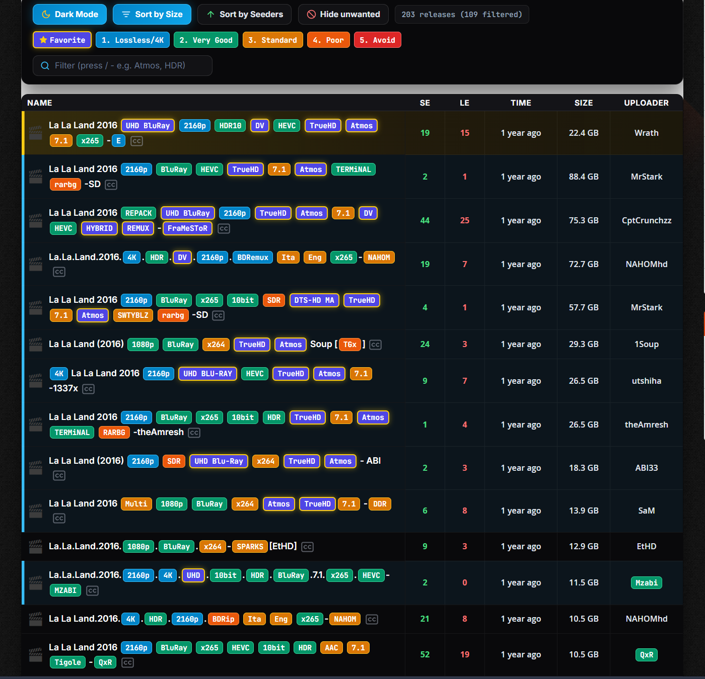
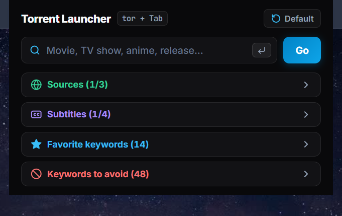
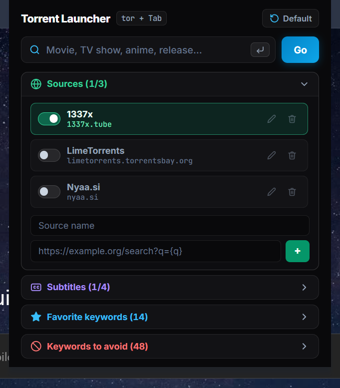
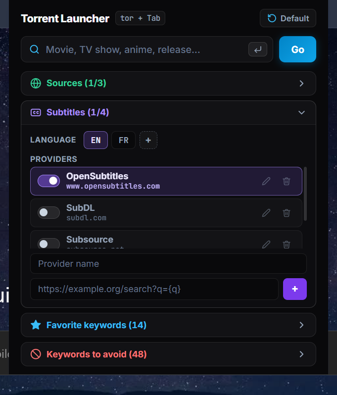
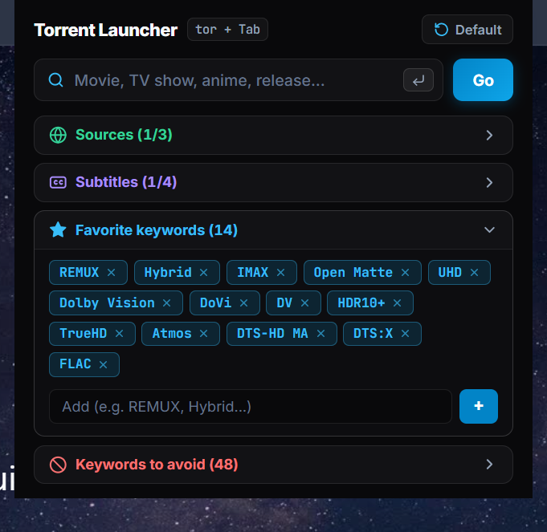
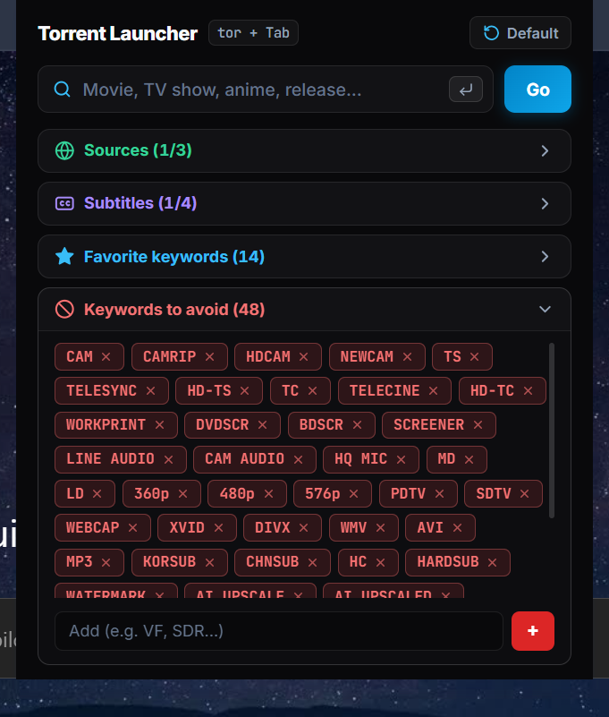

<div align="center">
  
  <h1>Torrent Highlighter</h1>
  <p>
    Turn cluttered torrent trackers into a fast, readable, keyboard-driven media workstation.<br>
    Zero-dependency Manifest V3 extension for Chromium and Firefox combining a Raycast-style multi-source launcher, parallel multi-page merging, instant local filtering, one-click multi-provider subtitle search, and a 5-tier thermal release highlighter.
  </p>
  <p>
    
    
    
    
    
  </p>
</div>

---

## 👀 Preview

<div align="center">
  
  <p><em>Enhanced results table in Dark Mode with reconstructed full titles, 5-tier thermal badges, Favorite highlights, Hide unwanted active, and inline CC subtitle lookup.</em></p>
  <br>
  <table>
    <tr>
      <td align="center" valign="top" width="50%">
        <br>
        <strong>Launcher Home</strong><br>
        <sub>430px Raycast-style launcher, tor + Tab hint, Default reset, and 4-drawer accordion</sub>
      </td>
      <td align="center" valign="top" width="50%">
        <br>
        <strong>Sources Drawer</strong><br>
        <sub>Built-in and custom torrent trackers with live odometer counter and CRUD controls</sub>
      </td>
    </tr>
    <tr>
      <td align="center" valign="top" width="50%">
        <br>
        <strong>Subtitles and Languages</strong><br>
        <sub>ISO 639-1 multi-language chips, inline 2-letter adder, and multi-provider toggles</sub>
      </td>
      <td align="center" valign="top" width="50%">
        <br>
        <strong>Favorite Keywords</strong><br>
        <sub>Customizable priority tags elevated with purple-and-gold badges in results</sub>
      </td>
    </tr>
    <tr>
      <td align="center" valign="top" colspan="2">
        <br>
        <strong>Keywords to Avoid</strong><br>
        <sub>Categorized unwanted tags struck through and automatically filtered by Hide unwanted</sub>
      </td>
    </tr>
  </table>
</div>

---

## 💡 What It Does and Why

Browsing public or custom torrent indexers manually involves constant friction:

1. **Truncated and unreadable release strings**: Long filenames such as `Movie.2024.2160p.UHD.BluRay.REMUX.DV.HDR10+.TrueHD.7.1.Atmos-FraMeSToR` get cut off right before the audio codec, HDR layer, or release group.
2. **Fragmented pagination**: High-bitrate Remuxes, specific language editions, or well-seeded packs are often buried on page 3, 5, or 7 while page 1 is cluttered with recent re-encodes.
3. **Low-quality noise and spam**: Zero-seeder dead torrents, cinema CAM/TS captures, AI upscales, hardcoded watermarks, and gambling-branded uploads sit right next to legitimate releases.
4. **Repetitive multi-tab workflows**: Checking multiple trackers for a title with punctuation (`Dune: Part Two (2024)`) and then manually stripping release tags to look up subtitles across providers wastes dozens of clicks.

**Torrent Highlighter** eliminates all four bottlenecks in a single lightweight extension:
- Launch normalized searches across your enabled trackers straight from the address bar (`tor + Tab`) or popup.
- Automatically merge up to **8 result pages in parallel** into a single deduplicated, sortable table while restoring truncated titles.
- Color-code **751 technical tags, codecs, HDR profiles, streaming services, editions, and release groups** across a 5-tier thermal scale so your eyes lock onto the exact quality level in milliseconds.
- Automatically hide dead (`0` seeders) and unwanted Tier 5 releases out of the box, filter locally in real time with `/` (`2160p atmos -sdr`), and open clean subtitle searches on any row in one click via `CC`.

---

## ✨ Features

### 1. 5-Tier Thermal Highlighting Engine (`751` Unique Patterns)

Every release title and uploader cell is parsed client-side against **751** deduplicated, priority-ordered patterns spanning 5 visual quality tiers plus customizable **Favorite** and **Avoid** lists. Compound tokens always take precedence over shorter prefixes (`HDR10+` > `HDR10` > `HDR`, `Dolby TrueHD` > `TrueHD`, `DTS-HD MA` > `DTS-HD` > `DTS`, `DDP 5.1 Atmos` > `DDP 5.1` > `DDP`), and glued channel layouts (`TrueHD7.1`, `FLAC2.0`, `AAC2.0`) are tokenized cleanly.

Context-aware regex lookarounds protect real movie and series titles from false positives - including `Mel Gibson`, `Arrow`, `Eureka`, `Radiance`, `The Lord of the Rings`, `Don't Look Up`, `Semi-Pro`, `WALL-E`, `House MD`, `Body Cam`, `VIDEO_TS`, `Alfred Hitchcock's Topaz (1969)`, `Casino Royale`, `Watermark (2013)`, `My Son Avi`, `Project Epsilon`, `Madame Web`, `The Bad Batch`, and `Mad Max`.

| Tier | Badge Label | Patterns | Representative Formats, Sources, Codecs, Editions, and Groups |
| :--- | :--- | :---: | :--- |
| **1** | **1. Lossless/4K** | **185** | `4320p`/`8K`, `2160p`/`4K`/`UHD`, `UHD Remux`/`BDRemux`/`DVD Remux`/`Remux`, Full Discs (`BD100`/`BD66`/`BD50`/`BD25`/`BDMV`/`BDISO`/`Untouched`), `IMAX Enhanced`/`IMAX DTS`/`IMAX`/`Dolby Cinema`/`Open Matte`/`Hybrid`, boutique labels (`Criterion`, `Arrow Video`, `Masters of Cinema`/`Eureka`, `Powerhouse Indicator`, `Second Sight`, `BFI`, `Kino Lorber`/`KLSC`, `StudioCanal`, `Vinegar Syndrome`, `Radiance`, `Carlotta`, `Potemkine`, `Warner Archive`), dynamic HDR (`Dolby Vision`/`DoVi`/`DV P5/P7/P8/P8.1/P8.4/P10`, `CMv4.0`/`CMv2.9`, `BL+EL+RPU`/`BL+RPU`, `FEL`/`MEL`, `HDR10+`), `12-bit`, lossless and spatial audio (`Dolby TrueHD`/`TrueHD`, `Dolby Atmos`/`Atmos`, `DTS-HD MA`, `DTS:X`, `Auro-3D`, `LPCM`/`PCM`, `FLAC`, `ALAC`, `WavPack`/`WAV`, `DSD`, `24-bit`), and flagship Remux/BD/Anime teams (`FraMeSToR`, `KRaLiMaRKo`, `BLURANiUM`, `CiNEMAniA`, `EPSiLON`, `ESiR`, `CtrlHD`, `EbP`, `HDMaNiAcS`, `DON`, `LoRD`, `HONE`, `WiLDCAT`, `CHD`, `Beatrice-Raws`, `Kawaiika-Raws`, `VCB-Studio`, `Coalgirls`, `THORA`, `-E`). |
| **2** | **2. Very Good** | **206** | `1440p`/`1080p`, `Blu-Ray`/`BD`, `WEB-DL`, `WEBMux`, `Apple ProRes`/`ProRes`, `Real Proper`/`Proper`/`Repack`/`ReRip`/`DirFix`/`Custom`, special and restored editions (`Director's Cut`, `Extended Cut`, `Ultimate Cut`, `Final Cut`, `Uncut`, `Unrated`, `4K Remastered`, `4K Restoration`, `Restored`, `Remastered`, `VL`), static HDR (`HDR10`, `HDR`, `HLG`, `PQ10`), modern video codecs (`HEVC`/`x265`/`H.265`, `AV1`, `VP9`, `VVC`/`x266`/`H.266`, `Hi10P`, `10-bit`, `4:4:4`), `HFR`/`120fps`/`60fps`/`50fps`, high-bitrate and streaming spatial audio (`DTS-HD HRA`/`HR`/`ES`/`DTS`, `Opus`, `Dolby Digital Plus`, `DDPA`, `DDP`/`DD+`/`E-AC-3` + `Atmos`/`JOC`), global streaming platforms (`Sony Pictures Core`/`BCORE`, `ATVP`/`Apple TV+`, `iTunes`/`iT`, `DSNP`/`Disney+`, `AMZN`/`Prime Video`, `NF`/`Netflix`, `HBO Max`/`HMAX`/`MAX`, `Movies Anywhere`/`MA`, `PCOK`/`Peacock`, `PMTP`/`Paramount+`, `Hulu`, `MUBI`, `Shudder`/`SHDR`, `SkyShowtime`, `STARZ`, `Hotstar`, `VUDU`/`FAH`, `Crunchyroll`/`CR`, `HIDIVE`, `ADN`, `Canal+`, `Arte`), and top WEB/Encode/Anime teams (`NTb`, `NTG`, `CMRG`, `TEPES`, `FLUX`, `KiNGS`, `RTN`, `PlayWEB`, `HHWEB`, `KONTRAST`, `TERMiNAL`, `QxR`, `Tigole`, `CMCT`, `FRDS`, `DAV1NCi`, `RAV1NE`, `SubsPlease`, `Erai-raws`, `VARYG`, `ToonsHub`, `Golumpa`, `EMBER`, `Judas`). |
| **3** | **3. Standard** | **201** | `1080i`, `WEBRip`, `WEB`, `x264`/`H.264`/`AVC`, `VC-1`, `MPEG-4`, `Hi444PP`, `READNFO`, `RETAIL`, `INTERNAL`, standard audio (`Dolby Digital`/`DOLBYD`, `DD 5.1`/`2.0`/`1.0`/`DD`, `AC-3`, `AAC-LC`/`AAC`, `7.1`/`6.1`/`5.1`/`2.0`/`1.0`, `Stereo`, `Mono`), regional and broadcast streaming (`Crave`/`CRAV`, `Bilibili`/`B-Global`, `Wakanim`, `Viu`, `iQIYI`, `WeTV`, `TVING`, `Wavve`, `Abema`, `WOWOW`, `AT-X`, `BBC`/`iPlayer`, `ITVX`, `All4`, `My5`, `NOWTV`, `OCS`, `FranceTV`/`FTV`, `TF1+`, `M6+`, `6play`, `Stan`, `Salto`, `Binge`, `Roku`, `MGM+`, `AMC+`, `Tubi`, `Freevee`, `Pluto TV`, `Plex`), multi-language, subtitle, pack, and 3D tags (`Multi-Subs`, `Multi-Audio`, `MULTI`, `Dual-Audio`, `Triple-Audio`, `TRUEFRENCH`, `VFF`, `VFQ`, `VOSTFR`, `ESubs`, `MSubs`, `Softsubs`, `Subbed`, `SDH`, `Complete Series`/`Season`/`Pack`, `Season Pack`, `COMPLETE`, `BATCH`, `3D`/`HSBS`/`HOU`, plus ISO/Scene language tags), and Scene/TV groups (`SPARKS`, `GECKOS`, `AMIABLE`, `DRONES`, `BLOW`, `DIMENSION`, `GOSSIP`, `SWTYBLZ`, `RARTV`, `NOGRP`, `PRO`). |
| **4** | **4. Poor** | **67** | `720p`/`720i`, micro-encodes (`HDLight`, `4KLight`, `MiniHD`, `MicroHD`, `mHD`), compressed disc and TV rips (`Blu-Ray Rip`, `BDRip`, `BRRip`, `HDRip`, `DVDRip`, `DVD9`/`DVD5`/`VIDEO_TS`/`DVDISO`/`DVDR`, `HDTVRip`/`HDTV`), `Dubbed`, `8-bit`, `SDR`, low-bitrate `HE-AAC`/`AAC-HE`, and micro-encode or re-encode groups (`YTS`, `YIFY`, `PSARips`/`PSA`, `MeGusta`, `Pahe`, `RARBG`, `GalaxyRG`/`GalaxyRG265`/`GalaxyTV`, `TGx`, `EZTV`, `ION10`/`ION265`, `RMTeam`, `VXT`, `ShAaNiG`/`Shanig`, `Ganool`, `MkvHub`, `MKVCage`, `HEVCBay`, `WorldMKV`, `EVO`, `LAMA`, `BONE`). |
| **5** | **5. Avoid** | **92** | Cinema captures and pre-release screeners (`CAM`, `CAMRip`, `HDCAM`, `HQCAM`, `NEWCAM`, `CLEANCAM`, `TS`, `Telesync`, `HD-TS`, `TSRip`, `TC`, `Telecine`, `HD-TC`, `PreDVD`/`PreDVDRip`, `Workprint`/`WP`, `DVDSCR`, `BDSCR`, `WEBSCR`, `Screener`, `R5`/`R6`), degraded/microphone audio (`Line Audio`, `Line Dubbed`, `LINE`, `Cam Audio`, `HQ Mic`, `Mic Dubbed`, `MD`, `LD`), very low resolutions (`576p`/`576i`, `480p`/`480i`, `360p`, `240p`, `SD`), legacy captures (`VHSRip`, `TVRip`, `SATRip`, `PPVRip`, `VODRip`, `PDTV`, `SDTV`, `DSRip`/`DSR`, `WEBCap`), obsolete codecs/containers (`XviD`, `DivX`, `WMV`, `AVI`, `MPEG-1/2`/`MPG`, `FLV`, `RMVB`, `3GP`, `MP3`, `WMA`, `OGG`), hardcoded subtitles and watermarks (`KORSUB`, `CHNSUB`, `HC`, `Hardsubs`/`Hardsub`, `Hardcoded`, `Watermark`), AI upscales (`AI Upscaled`, `AI Enhanced`, `AI Upscale`, `Topaz Video AI`/`Topaz`), and gambling spam (`1XBET`, `1XBIT`, `MELBET`, `MOSTBET`, `MEGAPARI`, `888STARZ`, `BET365`, `BETWINNER`, `LINEBET`, `PARIMATCH`, `PINUP`, `1WIN`, `22BET`, `CASINO`, `SLOT`). |
| **Favorite** | **Favorite** | **17 defaults** | User-curated priority tags rendered with an indigo-and-gold badge plus a subtle cyan row accent (`REMUX`, `Hybrid`, `IMAX`, `Open Matte`, `UHD`, `Dolby Vision`, `DoVi`, `DV`, `HDR10+`, `TrueHD`, `Atmos`, `DTS-HD MA`, `DTS:X`, `LPCM`, `FLAC`, `FraMeSToR`, `EPSiLON`). |
| **Avoid** | **Strikethrough** | **58 defaults** | User-curated unwanted keywords strictly aligned with Tier 5, struck through in crimson and hidden automatically whenever `Hide unwanted` is active. |

### 2. Raycast-Style Multi-Source Launcher (`tor + Tab`)

- **Omnibox and Popup Launching**: Type `tor` + `Tab` directly in the browser address bar or open the `430px` dark popup to launch searches across all enabled torrent sources simultaneously.
- **Outbound Query Normalization**: `normalizeSearchQuery` automatically strips Latin diacritics (`Amélie` -> `Amelie`), removes apostrophes without splitting words (`Ocean's Eleven` -> `Oceans Eleven`), and replaces tracker-breaking punctuation (`:`, `;`, `-`, `/`, `&`, parentheses) with clean spaces while preserving CJK, Cyrillic, and decimal audio tokens (`5.1`, `7.1`).
- **Built-in and Custom Sources CRUD**: Ships with `1337x` enabled by default plus `LimeTorrents` and `Nyaa.si` ready to toggle on. Add, edit, toggle, or delete custom trackers using `{q}` URL templates with automatic host permission requests and persistent dynamic content script registration.

### 3. Multi-Provider and Multi-Language Subtitle Search (`CC`)

- **Automatic Title Cleaning**: Clicking the inline `20x20` `CC` icon next to any release strips codecs, groups, brackets, and file extensions down to `Title + Year` (movies) or `Title + SxxExx` / season (series) before building the subtitle URL.
- **Configurable Providers**: Includes `OpenSubtitles` (enabled by default), `SubDL`, `Subsource`, and `SubtitleCat` in exact priority order, with full CRUD support for custom subtitle sites using `{q}`, `{q_plus}`, and `{lang}`.
- **ISO 639-1 Language Bar**: `EN` is active by default alongside `FR`, plus a neutral dashed `+` button that opens an inline `--` uppercase 2-letter ISO input (`es`, `de`, `it`, `pt`, `ja`, `ko`, etc.). Multiple active languages join with commas (`en,fr`), and disabling all chips falls back cleanly to `all`.
- **Pop-up Blocker Safe**: Batch subtitle lookups are dispatched to `background.js` via `tabs.create` and opened right next to the current tab so browser pop-up blockers never intercept multi-provider searches.

### 4. Injected Control Bar and Smart Table Filtering

- **3-Row Workstation Toolbar**: Injects cleanly above any detected torrent table with `Dark Mode`, mutually exclusive `Sort by Size` and `Sort by Seeders` (featuring an emerald active state matching the green `SE` column, and returning to native site order when both are toggled off), `Hide unwanted`, a live release counter, multi-select tier filter pills (`Favorite` + `1` to `5`), and a `/` real-time filter bar.
- **`Hide unwanted` Enabled by Default**: Immediately hides `0`-seeder dead rows and releases matching `Keywords to avoid`. If 100% of matching rows are hidden, a clickable inline table notice (`Click here or press H to show them`) lets you reveal them instantly; selecting `5. Avoid` (or pressing `5`) also disables `Hide unwanted` automatically so you can inspect Tier 5 rows without an extra click.
- **Enhanced Table Readability**: Row hover highlights the `SIZE` column in luminous cyan without altering `font-weight` (zero horizontal layout jitter) while keeping Seeders (`SE`) crisp green and Leechers (`LE`) crisp red in both Dark Mode and Light Mode.

### 5. Asynchronous Multi-Page Merging and Title Reconstruction

- **Parallel Pagination Aggregation**: Automatically fetches up to **8 pages** in parallel (`fetch` + `DOMParser`), displays a pulsing `Merging X/Y...` progress badge with a completion micro-pop, deduplicates entries by title and uploader, sanitizes every imported row, and keeps your active sort and filters live as pages arrive.
- **Loop-Free 1337x Size Pre-Sort**: Direct searches on 1337x without an explicit `order` parameter automatically redirect once to `order=length` so the largest, highest-bitrate encodes surface first.
- **Priority Uploader Pinning on 1337x (`Wrath`)**: Automatically detects releases uploaded by `Wrath` on 1337x, pins them to the top of the table across initial loads and multi-page merges (preserving their relative order under active size, seeder, or default sorting while respecting `/` and tier filters), and highlights them with a signature golden left accent and subtle warm golden tint.
- **Full Title Restoration**: Rebuilds truncated titles (`...`) from `title` attributes (such as Nyaa) or URL slugs while preserving hyphenated compound tags (`WEB-DL`, `DTS-HD`, `HDR10+`, `DD+`, `H.265`, `-Group`).

### 6. Physics-Driven Motion Design System

Every SVG icon and UI control is crafted with realistic inertia, impact, damping, and contextual color harmony:
- **Popup Controls**: Context-tinted focus `Scan Beam` sweeps (cyan on search, emerald in `Sources`, violet in `Subtitles`, sky-blue in `Favorite`, crimson in `Keywords to avoid` - never firing on keystrokes), `Radar Pulse` + `Launch Recoil` on `Go`, tactile mechanical `tor + Tab` keycap press, smooth CSS Grid accordion drawers with spring chevrons, 3D desk-globe spin on `Sources`, pop-and-hold `CC` on `Subtitles`, elastic sky-blue star on `Favorite keywords`, stubborn stop-bounce on `Keywords to avoid`, circular rim-impact toggle switches (`500ms`) paired with vertical `(X/Y)` odometer counters, hinged-lid trash delete with particle burst, counter-clockwise wind-up spin + left-to-right tag wave on `Default`, 3-beat spring tag arrivals, and **40-50 grain** left-to-right dust disintegration on tag/language removal.
- **Injected Controls and Table**: Full-button downward speed streaks + border-crossing `↑` elevator arrow on `Sort by Seeders`, staggered 3-bar physical re-sorting on `Sort by Size`, calm nocturnal moon cradle on `Dark Mode`, punchy prohibition stamp on `Hide unwanted`, 5-fold symmetric `72deg` spin on `Favorite`, cyan `Scan Beam` on `/`, and **18-24 particle** exponential-drag purple/lavender 4-point star bursts within a controlled `14px-38px` halo on `CC` hover and click.
- **Zero Leaks and Accessibility**: Every temporary particle self-cleans via `animationend` backed by a `setTimeout` safety net, and `@media (prefers-reduced-motion: reduce)` disables non-essential motion across both popup and page.

---

## 🚀 How to Use and Power Tips

### 1. Launch Multi-Source Searches from Anywhere
Type `tor`, press `Tab`, enter any movie, series, or anime title, and press `Enter` (or `Alt + Enter` to open in a new tab without replacing your current page). You can paste messy titles straight from IMDb, TMDB, or Letterboxd:
- `Dune: Part Two (2024)` -> normalized to `Dune Part Two 2024`
- `Spider-Man: Across the Spider-Verse` -> normalized to `Spider Man Across the Spider Verse`
- `Ocean's Eleven` -> normalized to `Oceans Eleven`

### 2. Combine Positive Terms and `-word` Exclusions in the `/` Filter
Press `/` on any results page to focus the local filter. Separate required terms with spaces or commas (AND logic), and prefix unwanted terms with `-` (2+ characters) to exclude matching rows immediately:
- `2160p atmos -sdr` - keep only 4K Atmos releases while excluding SDR encodes
- `remux -yts` - isolate Remux releases and strip out micro-encode retags
- `vostfr 1080p -hevc` - match 1080p VOSTFR releases while excluding HEVC/x265

Stack the `/` text filter simultaneously with multi-select tier badges (`1`-`5`, `f`) and `Sort by Size` (`p`) or `Sort by Seeders` (`s`).

### 3. Add Custom Torrent Trackers (`{q}`)
1. Open the extension popup and expand **Sources**.
2. Enter a display name (for example `MyTracker`) and its search URL containing `{q}` where the query belongs (for example `https://example.org/search?q={q}`).
3. Click `+` (or press `Enter`). Grant the browser's host permission prompt for that domain - Torrent Highlighter will automatically inject the control bar, 5-tier thermal badges, sorting, pagination merger, and `CC` buttons whenever you visit that tracker.

### 4. Configure Subtitle Providers and ISO 639-1 Languages
1. Expand **Subtitles** in the popup to toggle any combination of `OpenSubtitles`, `SubDL`, `Subsource`, `SubtitleCat`, or add your own custom subtitle site using:
   - `{q}` - percent-encoded normalized title (`Dune%20Part%20Two%202024`)
   - `{q_plus}` - plus-separated normalized title (`Dune+Part+Two+2024`)
   - `{lang}` - comma-joined active ISO 639-1 language codes (`en,fr`) or `all`
2. Click `EN` / `FR` to toggle preset languages, or click the dashed `+` chip to type any 2-letter ISO 639-1 code (`ES`, `DE`, `IT`, `PT`, `JA`, `KO`, `NL`, `PL`) into the `--` field and press `Enter`.

### 5. Customize Keyword Lists and Restore `Default` Anytime
- Expand **Favorite keywords** or **Keywords to avoid** to add single tags or comma-separated batches (for example `Criterion, LPCM, FraMeSToR` or `VF, SDR, x264`).
- Click **Default** in the top-right corner of the popup anytime to restore the default keyword lists, default source toggles (`1337x` active), default subtitle provider (`OpenSubtitles` active), default subtitle language (`EN`), and `Hide unwanted` (`true`), while keeping any custom trackers or custom subtitle providers you added.

---

## ⌨️ Keyboard Shortcuts

Page shortcuts are automatically ignored while typing inside `<input>`, `<textarea>`, `<select>`, or `contentEditable` elements, and whenever `Ctrl`, `Alt`, or `Meta` is held. Number keys `1` through `5` work seamlessly on both **QWERTY** and **AZERTY** keyboards.

| Key | Context | Action |
| :--- | :--- | :--- |
| `tor` + `Tab` | Browser address bar | Activate the Torrent Highlighter Omnibox multi-source launcher |
| `/` | Results page | Focus the local real-time filter bar |
| `Escape` | Filter bar / Popup | Clear and blur the `/` filter, or cancel active edit / `--` language input in the popup |
| `1` - `5` | Results page | Toggle multi-select filter for Tiers `1` to `5` (`5` automatically turns off `Hide unwanted`) |
| `f` | Results page | Toggle multi-select filter for `Favorite` releases |
| `p` | Results page | Toggle `Sort by Size` descending (mutually exclusive with `Sort by Seeders`) |
| `s` | Results page | Toggle `Sort by Seeders` descending (mutually exclusive with `Sort by Size`) |
| `h` | Results page | Toggle `Hide unwanted` (zero-seed and avoided keyword filtering) |

---

## 🏗️ Architecture and Security

```text
torrent-highlighter/
├── manifest.json          # Chromium MV3 manifest (single source of truth for version 1.0.0)
├── defaults.js            # Shared sorted keyword defaults, query normalization, URL builders, resolvers
├── background.js          # MV3 service worker / Firefox Event Page: Omnibox, CC tabs, dynamic script sync
├── content.js             # Table detector, 751-pattern 5-tier engine, control bar, page merger, CC sparkles
├── popup.html             # 430px Raycast-style dark UI, scoped styles, SVG icons, and CSS motion system
├── popup.js               # Exclusive accordion, tracker/subtitle CRUD, ISO language bar, particle physics
├── scripts/
│   └── build.ps1          # Zero-dependency PowerShell builder producing Chromium and Firefox zip packages
├── assets/
│   ├── icons/             # Extension icons (16px, 48px, 128px)
│   └── screenshots/       # Documentation screenshots (excluded from distribution zip archives)
├── .gitignore             # Ignores generated dist/ artifacts
└── LICENSE                # MIT License
```

### Engineering and Security Highlights

- **Zero External Dependencies**: Pure Vanilla JavaScript, HTML5, CSS3, and inline SVG (`document.createElementNS`) under Manifest V3 - zero npm runtime packages, bundlers, telemetry, or remote code.
- **Single Cross-Browser Codebase (Chromium + Firefox 121+)**: Uses the unified `const extApi = globalThis.browser ?? globalThis.chrome;` namespace alias everywhere. `background.js` guards `importScripts('defaults.js')` for Chromium service workers, while `scripts/build.ps1` generates a dedicated Firefox MV3 Event Page manifest (`background.scripts: ["defaults.js", "background.js"]` + `browser_specific_settings.gecko.strict_min_version: "121.0"`) and packages clean POSIX-path `.zip` archives excluding screenshots and build scripts.
- **Least-Privilege Dynamic Host Permissions**: Static `content_scripts` match only the built-in domains. Custom trackers request origin-scoped access via `extApi.permissions.request(...)` synchronously inside the user submit gesture (before any storage `await`, complying with Firefox's strict user-activation enforcement) and persist via `extApi.scripting.registerContentScripts`.
- **Strict Anti-XSS DOM Hygiene (Mozilla AMO Ready)**: Zero `innerHTML`, `outerHTML`, `insertAdjacentHTML`, `eval`, `new Function`, or inline event attributes anywhere in the codebase. All UI and badge rendering uses `createElement`, `createElementNS`, `textContent`, and `replaceChildren`. Rows fetched from additional pages via `DOMParser` pass through `sanitizeImportedRow`, stripping active tags (`script`, `iframe`, `object`, `embed`, `style`, `link`, `meta`, `base`, `template`, `noscript`), `on*` / `srcdoc` attributes, and dangerous protocols (`javascript:`, `vbscript:`, `data:text/html`) prior to DOM insertion.

---

## 📦 Installation

### Chromium Browsers (Chrome, Edge, Brave, Opera, Vivaldi)

1. Download `torrent-highlighter-v1.0.0-chromium.zip` from Releases (or generate it locally with `.\scripts\build.ps1`) and extract it to a permanent folder.
2. Navigate to `chrome://extensions/` (or `edge://extensions/`, `brave://extensions/`) and enable **Developer mode** in the top-right corner.
3. Click **Load unpacked** and select the extracted `chromium` folder.

### Firefox and Derivatives (Firefox, Zen, LibreWolf, Floorp)

- **Signed Release (`.xpi`)**: Open the signed `.xpi` package in Firefox (121.0+) or drag it into `about:addons`.
- **Temporary Developer Load**: Extract `torrent-highlighter-v1.0.0-firefox.zip` (or use `dist/firefox/`), open `about:debugging#/runtime/this-firefox`, click **Load Temporary Add-on...**, and select `manifest.json` inside that folder.

### Build From Source

Requires Windows PowerShell 5.1+ or PowerShell 7+ (zero Node.js or third-party build dependencies required):

```powershell
git clone https://github.com/vheictor/torrent-highlighter.git
cd torrent-highlighter
.\scripts\build.ps1
```

Generated artifacts in `dist/`:
- `dist/chromium/` and `dist/torrent-highlighter-v1.0.0-chromium.zip`
- `dist/firefox/` and `dist/torrent-highlighter-v1.0.0-firefox.zip`

---

## 📄 License

Distributed under the [MIT License](./LICENSE).
